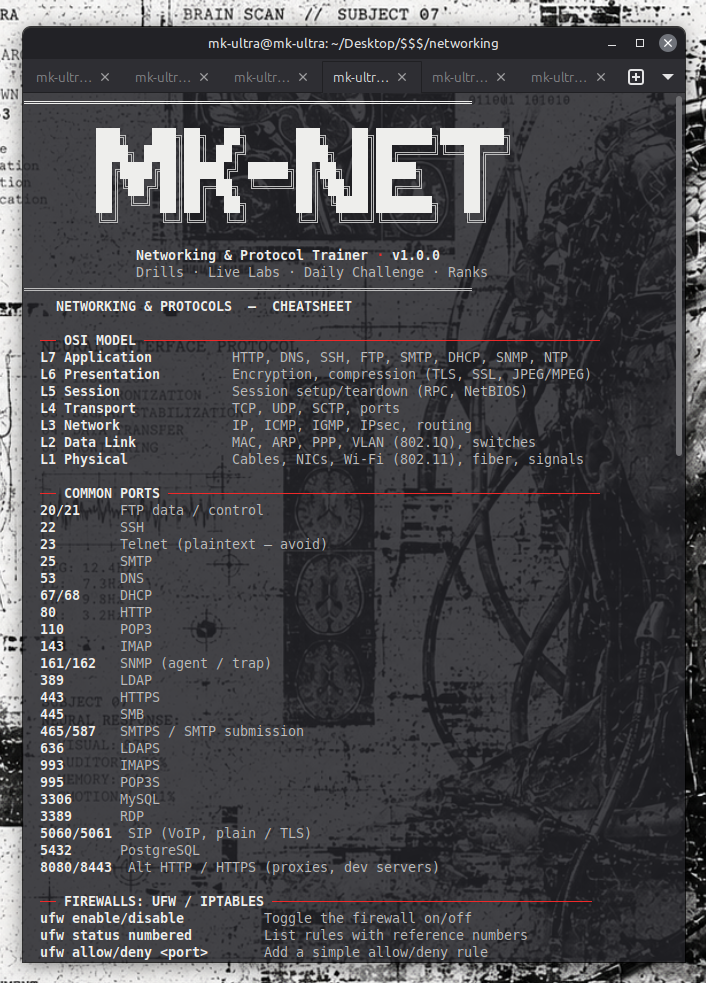
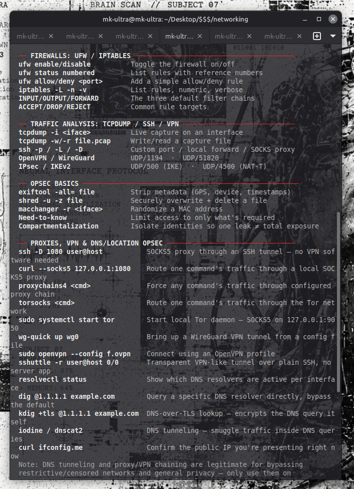

<div align="center">

# MK-NETDRILL

**Networking & Protocol Trainer** — a DIY OverTheWire-style terminal game.
Cheatsheet · Drills · Live Labs · Daily Challenge

by [MK-ULTRA](https://github.com/MK-ULTRA-MK-ULTRA)

</div>

---

## Screenshots

<div align="center">





</div>

---

## What is this?

MK-NETDRILL is a single-file bash script that turns learning networking into a game. You get a built-in cheatsheet, flash-card drills, command challenges, subnetting practice, and **live labs** where a real service spins up on your own machine and you hunt the flag with real tools (`ss`, `nmap`, `tcpdump`, `curl`, `nc`).

Answer questions, use hints when you're stuck, keep your daily streak alive, and watch the progress meter fill as you master questions and complete sections.

No frameworks, no pip installs, no accounts. One script.

---

## Features

| # | Mode | What it does |
|---|------|--------------|
| 1 | **Flash-card drill** | Ports, protocols, and OSI layers: type the answer |
| 2 | **Reverse drill** | "What is X?" You describe it, then self-grade |
| 3 | **Command challenge** | Write the command for the task (`ss`, `dig`, `nmap`, `nc`...) |
| 4 | **Subnetting drill** | CIDR, masks, network and broadcast math |
| 5 | **Firewall drill** | `ufw` and `iptables` |
| 6 | **Traffic analysis drill** | `tcpdump`, SSH tunnels, VPN ports |
| 7 | **OPSEC drill** | Metadata stripping, GPG, hashing, MAC randomization, hygiene |
| 8 | **Proxy/VPN/DNS drill** | SOCKS, Tor, WireGuard, OpenVPN, DNS leaks, DoT |
| 9 | **Live explore mode** | Guided prompts to run real commands on your own system |
| 10 | **Live Lab** | Hunt a real flag on your own machine (see below) |
| 11 | **Who owns this IP?** | Quiz plus a lookup tool that runs `whois`, reverse DNS, and `ss` for you |
| 12 | **Timed Blitz** | 60 seconds, mixed questions from every category |
| 13 | **Daily Challenge** | 5 questions, same set for everyone each day |
| 14 | **Progress, stats & log** | Progress meters, per-section breakdown, accuracy, streaks, recent session log |
| 15 | **Cheatsheet** | OSI model, common ports, firewall, traffic analysis, OPSEC, proxies/DNS |

### Live Labs

Each lab starts a small Python service bound to **127.0.0.1 only** on a random port, with a fresh flag every run. The service is killed when you leave the lab.

| Lab | Skill | Mission |
|-----|-------|---------|
| **Ghost Listener** | Port discovery | Find the rogue TCP listener in a port range, connect, read the flag |
| **Packet Catcher** | Packet capture | Sniff the UDP beacon on loopback with `tcpdump` |
| **Banner Grab** | HTTP headers | The flag hides in a response header, not the page body |

Three hints per lab. `skip` reveals the answer.

### Progress meter

The main menu shows two meters that fill as you work:

- **Questions**: a question is mastered the first time you answer it correctly without a reveal-level hint
- **Sections**: a section is complete when every question in it is mastered (drills, Reverse, IP quiz), you finish every Live Explore prompt, or you capture the flag in a lab (13 sections total)

Correct answers in the Blitz and Daily Challenge count toward mastery too. Drills show unmastered questions first, and option **14** shows a per-section breakdown. Day streak and best answer streak are tracked as well.

### Hints

Type `hint` at any answer prompt (drills, Reverse, IP quiz, Daily) for up to three levels of help:

| Level | What you get | Progress credit |
|-------|--------------|-----------------|
| 1 | A nudge for that section (which tool, which flag, where to look in the cheatsheet) | Yes |
| 2 | Word count, length, and first character of the answer | No |
| 3 | The answer with every other character masked | No |

Live Explore has its own hints for each prompt, and each lab has 3 hints at the `Flag>` prompt. The Timed Blitz has no hints.

### Quitting

Type `q` at any prompt to go back to the menu, so you never need Ctrl+C to get out of a section.

---

## Requirements

- **Linux** (Debian, Ubuntu, and Kali tested paths; uses GNU `date`)
- **Bash 4.3+** (uses namerefs, `mapfile`, and `${var,,}`)
- Standard tools, used by the labs, explore mode, and IP lookup:

| Tool | Used for | Package (Debian/Ubuntu/Kali) |
|------|----------|------------------------------|
| `python3` | Live Labs | `python3` |
| `ss` | Listener checks, IP lookup | `iproute2` |
| `whois` | Who owns this IP? | `whois` |
| `dig` | Reverse DNS | `dnsutils` |
| `tcpdump` | Packet Catcher lab | `tcpdump` |
| `nmap`, `nc`, `curl` | Lab hunting, explore mode | `nmap`, `netcat-openbsd`, `curl` |

Install everything at once:

```bash
sudo apt update
sudo apt install -y python3 iproute2 whois dnsutils tcpdump nmap netcat-openbsd curl traceroute net-tools
```

The quiz and cheatsheet modes work with nothing but bash. Missing tools only affect the labs and lookups, and the script tells you what to install.

---

## Install & Run

```bash
git clone https://github.com/MK-ULTRA-MK-ULTRA/MK-NETDRILL.git
cd MK-NETDRILL
chmod +x mk-netdrill.sh
./mk-netdrill.sh
```

Type the number of a mode at the menu. Type `q` at any prompt to return to the menu.

---

## Saved Data

Progress is stored locally in `~/.mk-netdrill/`:

| File | Contents |
|------|----------|
| `stats` | Streaks, best blitz, labs solved, accuracy |
| `progress` | Which questions and sections you've mastered |
| `session.log` | Timestamped log of every answer |

To wipe your progress, open option **14** and type `reset`, or just delete the folder:

```bash
rm -rf ~/.mk-netdrill
```

---

## Adding Your Own Questions

Questions live in plain bash arrays in the `DATA` section of the script, in the format:

```
"question|answer|explanation"
```

Add a line to any array (`FLASH_QS`, `CMD_QS`, `FIREWALL_QS`, `TRAFFIC_QS`, `OPSEC_QS`, `PROXY_QS`, `SUBNET_QS`) and it shows up in that drill, the Blitz, and the Daily Challenge, with hints and progress tracking included automatically. The level 1 hint for each drill comes from the `SECTION_TIP` list in the script. Don't use the `|` character inside a question, answer, or explanation. IP quiz entries use `ip|owner keywords|owner shown|explanation`.

---

## Safety & Ethics

- All lab services bind to `127.0.0.1` only. Nothing is exposed to your network.
- The cheatsheet and drills cover tools like `nmap`, `tcpdump`, proxies, and DNS tunneling. Use them **only on systems and networks you own or are explicitly authorized to test.**
- Ownership data in the IP quiz can change over time. Always verify with `whois`.

---

## Roadmap

- [ ] More lab types
- [ ] IPv6 drills
- [ ] More subnetting questions
- [ ] Export stats

---

## License

MIT. See [LICENSE](LICENSE).

---

<div align="center">

**MK-ULTRA** · [GitHub](https://github.com/MK-ULTRA-MK-ULTRA)

*Keep drilling.* 📡

</div>
